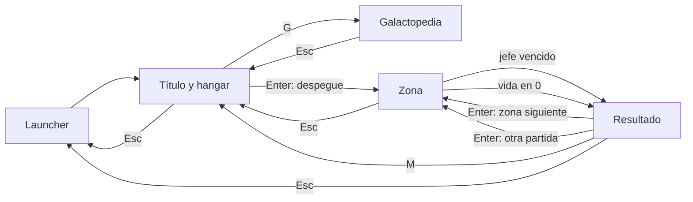

# Galáctica

Shooter de formaciones con vista desde abajo: los enemigos entran en vuelos
curvos, se acomodan en formación y bajan a atacar. Cada zona es una familia de
enemigos con sus propios ataques, la nave del jugador evoluciona durante la
partida y el hangar guarda las naves desbloqueadas entre partidas.

Es un juego del género, no una copia de uno en particular: las familias, los
ataques, la energía y la evolución son propios, y no se toman sprites ni
mecánicas puntuales de otros juegos.

## Qué hay hoy

El plan completo está implementado:

- Módulo con claves `galactica:*`, manifiesto en el catálogo y portada propia
  en el launcher.
- **Título** con el **hangar** dibujado: la nave elegida en la plataforma, las
  otras estacionadas a los costados (las bloqueadas, como silueta) y la ficha
  de la nave con su descripción, sus números y sus tres etapas. Al despegar, la
  nave sale volando por la boca de la bahía.
- **Galactopedia** con todo lo que hay que saber, en cinco páginas y con
  ejemplos vivos (ver [Galactopedia](#galactopedia)).
- **Cuatro zonas** de tres oleadas y un jefe cada una, con su familia, su cielo
  y sus eventos.
- Entradas en curva, formación que se balancea y respira, y los seis ataques
  del [catálogo](#catálogo-de-ataques), incluidos los dos kamikazes.
- **Eventos:** pods, asteroides y lluvia de cometas.
- **Vida y energía** en porcentaje, con recargas; **evolución** mk1 → mk3 por
  núcleos y tres **mejoras** temporales.
- **Resultado** de cada zona con tiempo, derribos, daño por fuente, bonus,
  récord y naves desbloqueadas.
- Estado en `state/`, sin Phaser adentro, y un **simulador**
  (`npm run sim:galactica`) que juega campañas enteras.
- Arte en pxl (`art/galactica/`) y un script que arma las hojas (`npm run art`).
- Recorrido de capturas: `npm run shots -- galactica`.

## Controles

| Tecla | Acción |
| --- | --- |
| ← → o A D | Mover |
| Espacio, Z o J (mantenidas) | Disparar |
| P | Pausa |
| Esc | Volver al título |

En el título, ← → eligen nave, Enter despega y G abre la Galactopedia, donde
← → cambian de página, ↑ ↓ eligen y Esc vuelve. En el resultado, Enter sigue (o
reintenta), M vuelve al título y Esc al arcade.

## Decisiones tomadas

- **Vida en porcentaje, no vidas.** Cada golpe resta según su tipo: un disparo
  resta poco, una explosión de kamikaze bastante y un choque mucho. Después de
  un golpe hay 0,8 s de invulnerabilidad, con la nave parpadeando.
- **La energía es el reloj de la zona.** Baja sola: llena dura entre 120 y
  135 s según la zona. Cuando llega a cero no se pierde en el acto: empieza a
  drenar la vida (2,5 % por segundo). Es presión, no un game over seco.
- **Tanto la vida como la energía se recargan.** Pods, comandantes, asteroides
  y jefes sueltan cápsulas. Es la recompensa por arriesgarse a ir a buscarlas.
- **Power-ups y desbloqueos.** Dentro de la partida la nave evoluciona y junta
  mejoras temporales; fuera de ella, el hangar conserva las naves conseguidas.
- **La partida sigue de zona en zona.** Se arrastran el puntaje, los núcleos, la
  vida (con un 20 % de curación al pasar) y lo que quede de cada mejora, que se
  congela entre zonas. La energía vuelve a llenarse. El resultado lo muestra
  con flechas: `21% → 41%`.
- **El jefe suelta lo que se lleva.** Una vida y un núcleo, no energía, que se
  llenaría igual. Vencido el jefe, todas las cápsulas que queden vuelan solas
  hacia la nave y la zona recién se cierra cuando las juntó: el premio no puede
  depender de alcanzarlo antes del corte.
- **Al pasar de zona, lo que sobra se cobra.** El bonus de zona suma 10 puntos
  por cada punto de energía y 5 por cada punto de vida: terminar rápido y sano
  vale.
- **Derribar a una nave fuera de la formación vale el doble.** Es la que está
  atacando, y la que más cuesta.

## Gráficos

Las naves se dibujan con [pxl](#arte-con-pxl) y todo lo demás con `Graphics`
de Phaser.

| Con pxl | Con Phaser |
| --- | --- |
| Tres naves del hangar con sus tres etapas | Disparos y cometas con estela |
| Doce enemigos (cuatro familias, tres rangos) y la esquirla | Chispas y ondas de las explosiones |
| Pod, dos asteroides, seis cápsulas | Fondo de estrellas en tres capas y nebulosa |
| Cuatro jefes de 32×32 | HUD, barras y avisos de peligro |

- **Celda fija de 16×16.** Todas las naves comparten la dimensión máxima; las
  variantes se dibujan adentro. Las cápsulas miden 12×12 y los jefes 2×2 celdas.
- **Escala ×3:** cada nave mide 48 px en el diseño de 800×600. La formación
  tiene 8 columnas separadas 52 px.
- **Sin contorno.** A 16 px el borde cuesta dos columnas y sobre el negro del
  espacio no se vería; las siluetas se separan del fondo por valor.
- **El jugador mira hacia arriba y los enemigos hacia abajo.** En vuelo, Phaser
  rota la textura hacia donde va la nave; a ×3 se sostiene.
- **Filtro `NEAREST`.** El arcade no usa `pixelArt: true` y `renderScale` hace
  zoom en la cámara, así que `sharpenGalacticaArt` pone cada hoja en
  `Phaser.Textures.FilterMode.NEAREST`. Si no, el pixel art sale borroso.
- **Una imagen por entidad.** `SpriteLayer` mantiene una `Image` por id del
  estado: crea las que aparecen, mueve las que siguen y destruye las que ya no
  están. La batalla nunca toca Phaser.
- **Los destellos salen del estado.** El blanco de un impacto, el parpadeo de un
  kamikaze plantado o de la nave invulnerable se calculan con los timers de la
  batalla y un tinte de relleno (`TintModes.FILL`).

## Zonas y familias

Una zona es un nivel: tres oleadas y un jefe. La familia de la zona define qué
naves aparecen y cómo atacan.

| Zona | Familia | Carácter |
| --- | --- | --- |
| 1 | Terrestres | Rizos prolijos y disparos rectos. Pods y asteroides. |
| 2 | Insectos | Enjambre: casi todo picadas, y el comandante se planta. Pods y cometas. |
| 3 | Cristales | Blindados. Disparos que se parten; la élite se rompe en esquirlas. Muchos asteroides. |
| 4 | Míticas | Dragones con mucha vida, fuego en helicoide y abanicos. Cometas. |

Dentro de cada familia hay rangos (soldado, élite, comandante). Un rango nuevo
es la misma nave con otra pintura y otros números: una línea en el `.px.js` y
una entrada en `ENEMIES` (`constants/families.ts`).

Las oleadas se escriben como dibujos, fila por fila (`constants/zones.ts`):

```ts
{ formation: ['...33...', '.222222.', '11111111', '11111111'], entries: ['top', 'swirl', 'loop', 'side'] }
```

`.` es un casillero vacío y el número, el rango. Cada fila entra después de la
anterior con su trayectoria; la mitad izquierda llega por la izquierda y la
derecha por el espejo.

### Jefes

Cada jefe entra desde arriba, se pasea de lado a lado y repite un ciclo de
movimientos. Con la mitad de la vida se enoja: se mueve más rápido, acorta las
pausas y cada movimiento es más largo.

| Movimiento | Qué hace |
| --- | --- |
| Abanico | Ráfagas de siete disparos apuntados. |
| Helicoide | Pares de helicoides desde los dos costados. |
| Espiral | Dos chorros que giran, al estilo de un aspersor. |
| Escolta | Suelta tres o cuatro naves de su familia en picada. |
| Carga | Marca una columna, tiembla y se tira contra el jugador. |

Al jefe se le pega en una caja del ancho del sprite, no en un círculo: el
simulador mostró que, con un círculo, casi todo disparo erraba mientras el
jefe se movía (ver [simulador](#lo-que-enseñó-el-simulador)).

## Comportamiento de los enemigos

1. **Entrada.** Cada nave sigue una curva Catmull-Rom por los puntos de su
   trayectoria hasta el casillero quieto, y después persigue el casillero
   real, que se está moviendo.
2. **Formación.** Se balancea de lado a lado mientras entran; con todos
   adentro, además respira: se abre y se cierra.
3. **Ataque.** Cada tanto una nave deja su casillero con una maniobra elegida
   por peso entre las de su rango. Cuantas menos quedan, más seguido atacan, y
   con menos del 30 % se permite un atacante más: el final de la oleada no
   puede ser un trámite.

Las trayectorias se recorren por distancia, no por el parámetro de la curva
(`state/paths.ts`): así la velocidad es pareja aunque los puntos estén
desparejos.

## Catálogo de ataques

Los ataques son datos (`constants/attacks.ts`): cada rango combina un patrón de
disparo con una maniobra.

| Disparo | Qué hace |
| --- | --- |
| Directo simple | Uno, apuntado al jugador con un máximo de 26°. |
| Directo doble | Dos paralelos, rectos hacia abajo. |
| Helicoide | Dos que comparten la línea central y se enroscan uno alrededor del otro. |
| Abanico de 3 | Apuntado, abierto ±16°. |
| Abanico de 5 | Recto, abierto ±30°. |
| Partido | Baja recto y a mitad de camino se parte en dos que se desvían a los costados. |

| Maniobra | Qué hace |
| --- | --- |
| Rizo | Sale hacia un costado, baja hacia el jugador disparando y vuelve por arriba a su casillero. |
| Kamikaze en picada | Tiembla, se tira recto adonde estaba el jugador y sigue de largo. |
| Picada con vuelta | Igual, pero vuelve a la formación. |
| Kamikaze plantado | Se ubica en la línea del jugador, parpadea cada vez más rápido y explota en área. |

El kamikaze plantado se queda justo encima de la línea del jugador: para
derribarlo hay que ponerse debajo, cerca de la explosión. El radio se ve en
rojo y late más rápido a medida que se acaba la cuenta.

## Eventos

Aparecen cada 10 a 22 s según la zona, elegidos por peso de su lista.

- **Pod.** Cruza de costado. Al romperlo es una apuesta: 55 % de una recarga,
  45 % de una emboscada de tres naves en picada.
- **Asteroides.** De tres a cinco rocas que bajan girando. Tapan los disparos
  de los dos lados, chocarlas duele y, rotas, a veces sueltan energía o vida.
- **Lluvia de cometas.** Primero se marcan arriba las líneas por donde van a
  pasar, con la misma pendiente; después caen siete cometas que no se pueden
  derribar.

## El jugador

- **Vida (%)** y **energía**, en dos barras siempre visibles. La vida titila
  por debajo del 25 %; la energía, al vaciarse.
- **Evolución.** La nave sube de etapa con núcleos: mk2 con 3, mk3 con 8. Cada
  etapa cambia la silueta y la salva.
- **Mejoras temporales:** escudo (bloquea todo, 8 s), doble (duplica cada
  disparo, 12 s) y turbo (más velocidad y cadencia, 10 s).
- **Hangar.** Tres naves, guardadas en `localStorage` como `galactica.hangar`.

| Nave | Carácter | Salvas mk1 → mk3 | Se consigue |
| --- | --- | --- | --- |
| Halcón | Equilibrada | 1 → 2 → 3 en abanico | Desde el principio |
| Aguja | Rápida, frágil, cadencia alta | 1 → 1 que atraviesa → 2 que atraviesan | Venciendo al jefe de la zona 1 |
| Bastión | Lenta, blindada | 2 → 3 → 5 en abanico | Venciendo al jefe de la zona 3 |

El récord se guarda como `galactica.highScore`.

## Título y hangar

El título es el hangar de la nave. Está dibujado con `Graphics`: paredes con
costillas, la compuerta abierta con estrellas que pasan, franjas de peligro,
grúas, piso en perspectiva y tres plataformas. Las luces del techo, el anillo
de la plataforma y las balizas de las grúas se mueven.

- **Elegir nave** la sube a la plataforma como en un montacargas; las otras dos
  quedan estacionadas a los costados. El anillo de la plataforma es celeste si
  la nave está en el hangar y rojo si está bloqueada.
- **La ficha** muestra la descripción, velocidad, blindaje y cadencia en barras
  y las tres etapas con su salva. Si la nave está bloqueada, dice cómo
  conseguirla.
- **El despegue** tiene tres tiempos: los motores se encienden y la nave
  tiembla (0,55 s), sube por la bahía acelerando con su llama y una lluvia de
  chispas, y la pantalla destella y se funde antes de empezar la zona.

## Galactopedia

Reúne todo lo que antes estaba en el título y lo que antes había que leer acá.
Tiene cinco páginas:

| Página | Qué tiene |
| --- | --- |
| Cómo jugar | Vida y energía, qué pasa entre zonas, puntos, controles, las seis cápsulas, la evolución por núcleos y las cuatro zonas. |
| Naves | Las tres naves del hangar, con sus números, cómo se consiguen y la salva de cada etapa. |
| Enemigos | Los doce rangos y la esquirla: vida, puntos, disparo, maniobras y cuánto sueltan. |
| Ataques | Los seis disparos y las cuatro maniobras, con su daño y quién los usa. |
| Eventos y jefes | Pod, asteroides y cometas; los cuatro jefes con su ciclo de movimientos. |

Las cuatro páginas con lista tienen un **ejemplo vivo** al costado
(`objects/PediaDemo.ts`): una `Battle` de verdad en modo banco de pruebas
(`battle.sandbox()`), sin oleadas ni eventos al azar, en la que un guion
provoca lo que se está mostrando. La nave del ejemplo se mueve sola y no
muere. Así la Galactopedia no tiene una segunda implementación de los
ataques: el helicoide que se ve es el del juego.

El ejemplo se dibuja con los mismos renderers que la partida, lejos de la
pantalla (en x = 3000), y una cámara propia lo muestra achicado en el
recuadro. Esa cámara se dibuja encima de la principal: lo que tenga que verse
sobre el ejemplo va afuera del recuadro.

Los datos de las fichas salen de las constantes, no de textos: si cambia la
vida de un jefe o el daño de un abanico, la Galactopedia se actualiza sola.

## Lo que enseñó el simulador

`npm run sim:galactica` juega campañas enteras con cada nave y un piloto
automático que esquiva mirando medio segundo adelante. Dos cosas cambiaron por
lo que midió:

- **Los jefes duraban más de cien segundos.** El disparo tarda 0,6 s en llegar
  y en ese tiempo el jefe se corre unos 40 px: con un círculo de impacto sólo se
  le pegaba cuando daba la vuelta. Se pasó a una caja del ancho del sprite, se
  bajó la vida de los jefes (45, 60, 75 y 95) y el piloto aprendió a adelantar
  la puntería. Ahora un jefe dura entre 15 y 35 s.
- **La energía no apretaba.** Con 170 s por zona sobraba más del 60 %. Se bajó
  a 120–135 s: al piloto le sobra la mitad, y una persona, que tarda más, llega
  más justa.

Lo que todavía dice: el daño viene sobre todo de los **choques** contra naves
en picada, y casi nada de los disparos. El piloto esquiva mejor que una
persona, así que el ajuste fino de la dificultad hay que hacerlo jugando.

## Arte con pxl

- Las fuentes viven en `art/galactica/`: `palette.px.js` (la paleta común),
  `ships.px.js` (naves, enemigos, eventos y cápsulas) y `bosses.px.js`.
- `sheet()` genera un PNG y un JSON en el formato de TexturePacker, que Phaser
  carga con `load.atlas`: un pedido por hoja, no uno por nave.
- `npm run art` (`scripts/build-art.mjs`) reconstruye las hojas y las copia a
  `public/assets/galactica/`. pxl vive en las skills de Claude, no en el
  repositorio, así que **las hojas generadas se versionan**: el build y el
  deploy no lo necesitan. Si pxl está en otro lugar, se indica con `PXL=`.
- `public/_headers` revalida esas hojas en cada visita: no llevan hash en el
  nombre, como los JS de Vite.
- Una variante de rango es un `swap` de colores; una etapa de evolución se
  pinta encima de la anterior con `base`. Las cápsulas usan dos colores
  comodín (`W` y `X`) que cada una reemplaza.
- Correr pxl junto a un `.px.js` crea una carpeta `out/` al lado, que está
  ignorada en Git; `art/` está fuera del watch de Vite.

## Estructura

```text
src/games/galactica/
├── index.ts
├── sceneKeys.ts          # galactica:*
├── audio.ts
├── galactica.md
├── constants/
│   ├── tuning.ts         # campo, velocidades, daño, energía, recargas
│   ├── ships.ts          # el hangar: naves, salvas por etapa, desbloqueo
│   ├── families.ts       # rangos de cada familia y jefes
│   ├── attacks.ts        # el catálogo de disparos y maniobras
│   └── zones.ts          # oleadas, trayectorias de entrada, eventos y cielo
├── state/                # sin Phaser adentro
│   ├── Battle.ts         # una zona entera
│   ├── Formation.ts
│   ├── paths.ts
│   ├── hangar.ts         # naves conseguidas y récord
│   └── rng.ts
├── objects/
│   ├── art.ts            # carga de las hojas y filtro NEAREST
│   ├── SpriteLayer.ts    # una Image por entidad del estado
│   ├── PediaDemo.ts      # los ejemplos vivos de la Galactopedia
│   ├── battleRenderer.ts # disparos, avisos, efectos y vistas de los sprites
│   ├── Starfield.ts
│   └── labels.ts
└── scenes/
    ├── GalacticaTitleScene.ts
    ├── GalacticaPediaScene.ts
    ├── GalacticaGameScene.ts
    └── GalacticaResultScene.ts
```

Como en Tanques, la partida avanza a pasos fijos de 1/60 s. La escena traduce
el teclado a `Battle.setInput`, dibuja lo que hay en sus listas y suena lo que
encuentra en `battle.events`, que vacía después de leer.

## Flujo entre escenas



## Audio

El combate usa Sci-Fi Sounds de Kenney: el láser corto para el disparo propio
(suena hasta cada 90 ms), impactos metálicos, explosiones de dos tamaños, el
campo de fuerza para el escudo y una compuerta para las cápsulas. Avisos,
premios, evolución, fin de zona y fin de partida usan Digital Audio, con tonos
de arcade. Los menús siguen con los efectos de interfaz del resto del arcade.
Todo está en `audio.ts`: cambiar un sonido es cambiar una URL del catálogo
(se copia desde el Jukebox). Hay tres músicas:
el título (*Lost in Space*), las oleadas (*Retro-Synthwave*) y los jefes
(*Cloak of Darkness STAGE 3*).

## Ideas por pensar

- Una mecánica propia que ocupe el lugar de "capturar la nave": algo que
  convierta el peligro en recompensa.
- Que los rangos de élite tengan comportamiento propio y no sólo más vida.
- Disparos de cristal que reboten en los bordes.
- Más zonas: con oleadas escritas como dibujos, sumar una es sumar datos.
- Escoltas para los comandantes en sus rizos.
