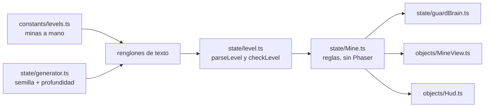
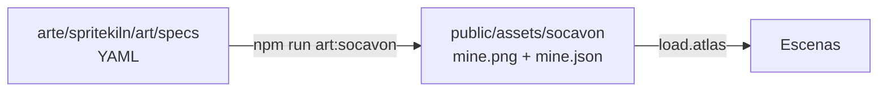

# Socavón

Sigilo con luz y ruido en una mina vertical. Hay que robarle la llave a un sereno, abrir la bóveda
y sacar todo el botín por el montacargas, con la campana sonando.

Es un juego propio del género de plataformas de una pantalla por galería, escaleras y botín. Los
personajes, las minas y las reglas de sigilo son de Socavón.

## Controles

| Tecla | Mando | Qué hace |
|---|---|---|
| ← → / A D | Cruceta o stick | Caminar, cruzar por las manijas, salir del nicho |
| ↑ ↓ / W S | Cruceta o stick | Escalera. ↑ bajo un agarre cuelga y en un nicho esconde; ↓ colgado suelta |
| Espacio | A | La acción del momento, que se lee abajo de la pantalla |
| Z | B | Apagar o prender la lámpara de al lado |
| X | X | Linterna del casco |
| P / Esc | Start / Select | Pausa / menú |

En el título, Enter o A baja a la mina, ← → cambia el modo, N o Y pide otra semilla y Esc o B
vuelve al arcade. En el resultado, Enter o A juega otra vez, M o Y va al menú y Esc o B al arcade.
Es el esquema común del arcade (`core/input/controls.ts`, ver
[docs/tareas/mando.md](../../../docs/tareas/mando.md)); se prueba con `npm run test:mando`.

## Reglas

- **Botín.** Una bolsa por vez, y frena: cargado se corre menos que un sereno. Soltarla es la forma
  de escapar. La mina termina al entregar todo.
- **Carretilla.** Junta hasta tres bolsas al pasar, pero se oye y no sube escaleras ni cruza pozos.
  Suelta, queda mirando para donde se la llevaba.
- **Llave y bóveda.** La llave se saca por la espalda, o a un sereno aturdido. Cada bóveda gasta una
  llave y da dos bolsas.
- **Campana.** Abrir la bóveda la hace sonar 20 segundos: los serenos van para ahí y se apuran. Se
  calla con Espacio junto a una campana. Callada, Espacio con las manos libres la toca: suena 8
  segundos y es la forma de distraer a los serenos, salvo al que te persigue o está aturdido. Lo
  tirado al lado se levanta antes y, cargado, Espacio suelta la bolsa.
- **Luz.** Con linterna o bajo una lámpara, un sereno ve a 8 celdas; a oscuras, a 2,2. Su haz
  dibuja ese alcance real. Al pasar vuelven a prender las lámparas apagadas hace más de 10 segundos.
- **A tientas.** Sin linterna y lejos de una lámpara prendida, se camina y se trepa al 60 %.
  Colgado de las argollas, no: ningún pozo deja de cruzarse.
- **Destello.** La linterna se ve de punta a punta de la galería: un sereno que mira para tu lado,
  sin muro en el medio, va a mirar adonde estás, aunque la apagues enseguida. Si está más cerca
  que su vista, directamente te ve.
- **Encendedor.** Lejos de una lámpara prendida, cada sereno lo lleva en alto en la mano de
  adelante: alumbra una celda a su alrededor y, a oscuras, se ve la llamita. A él no le cambia
  nada; conoce la mina.
- **Ruido.** El pico, la carretilla y las caídas se oyen en la galería y, atenuados, en las vecinas.
- **Manijas.** Cruzan pozos con las manos libres. Los serenos no pueden seguirte. Gastan la misma
  barra que el agarre: agotada, se cae a la galería de abajo o, si no hay, al fondo y se pierde una
  vida. Ningún pozo es tan largo que no se cruce con media barra.
- **Muros.** Tres golpes de pico. Tapan la vista.
- **Vagoneta.** Tiembla antes de salir. En marcha atropella al minero y aturde a los serenos;
  detenida no le hace nada a nadie. En el medio de su riel suele haber un nicho.
- **Agarre.** Un hierro en C en el techo de cada riel. Con las manos libres, ↑ cuelga al minero y la
  vagoneta le pasa por abajo. Aguanta 6 segundos, tiembla y cae. Para volver a agarrarse tiene que
  llenarse la barra. Colgado ahí, un sereno lo agarra venga de donde venga.
- **Viajar.** Cayéndole encima, desde el agarre o desde un pozo, se queda adentro: hay una celda de
  margen. De frente mata. Detenida, Espacio sube y baja, con bolsa o pico y sin carretilla. Lo que
  esté tirado ahí se levanta antes de subir.
- **Testigo.** Agachado en la vagoneta no lo ven ni lo agarran, salvo quien lo perseguía y lo vio
  subir: ése lo agarra si lo toca con la vagoneta detenida. Deja de ser testigo si lo pierde o
  queda atropellado.
- **Nichos.** Esconden de serenos y vagonetas, salvo que te metas con un perseguidor encima. El
  sereno que pasa se dibuja por delante del escondido.
- **Siempre hay otro camino.** Ningún objetivo queda al final de un camino único: un sereno parado
  en cualquier lugar se rodea por otra galería, de ida y con el botín de vuelta.
- **Serenos que circulan.** No descansan en rieles ni escaleras. Si no pueden llegar a quien ven,
  dan la vuelta o, si no hay vuelta, desisten. Recién atropellados salen del riel, se alejan y por
  4 segundos, mientras parpadean, la vagoneta no los vuelve a tirar.
- **Entrada.** La patrulla no pasa por la galería de arriba: es el respiro al llegar y al revivir.
  Un ruido o una persecución sí pueden llevar a un sereno hasta ahí.
- **Lo que se ve.** Lo que está a la vista y además iluminado. A la vista está la galería en la
  que estás, hasta la roca o un muro sin romper, como para el sereno. Al empezar a trepar o a
  caer, y colgado de las argollas, también la de abajo o la de arriba, dos celdas a cada lado; en
  el medio de la escalera, las dos enteras. Iluminado está el halo del minero (una celda a cada
  lado), el haz de la linterna (cinco celdas hacia adelante y, en la escalera o colgado, la otra
  punta), las lámparas prendidas y los encendedores. Una lámpara prendida se ve desde lejos. Se
  puede dar la vuelta a mitad de escalera: asomarse es gratis.
- **Lo que se recuerda.** Lo que se dejó de ver queda fijo, como se lo vio, en gris azulado, y se
  apaga a negro en 12 segundos. Un sereno que se fue sigue en el recuerdo hasta que se vuelve a
  mirar ahí; una lámpara que se prende no cambia en el recuerdo. Lo nunca visto es negro.
- **Lo que se oye.** Los pasos de los serenos (corriendo, desde más lejos), las vagonetas en
  marcha y la campana, como el sereno oye al minero: entero en la propia galería, atenuado en la
  de arriba y la de abajo, y a través de muros y roca. Donde no se ve, cada paso o traqueteo deja
  una onda en su lugar, que no queda en el recuerdo. Suena más bajo cuanto más lejos y del lado
  de donde viene; lo que no se oye, como una vagoneta que arranca tres galerías abajo, no suena.
- **Escaleras largas.** Con ← o → apretado se baja en el piso del medio; si no, se sigue de largo.

Los números están en `constants/tuning.ts`.

## Módulo



`Mine.step(dt, input)` avanza el estado y devuelve eventos. La escena los convierte en sonidos y
efectos.

Qué se ve en vivo es una regla sin Phaser (`state/vision.ts`, con tests): lo que está a la vista
(`liveSpans`) cortado por lo iluminado (`lightSpans`). La vista guarda cuándo
se vio por última vez cada tile (`objects/sight.ts`) y con eso tiñe: en vivo, la luz; si no, el
recuerdo o negro. Serenos y vagonetas tienen dos sprites, el real, que sólo se muestra en vivo, y
una copia fija del último cuadro visto, para que el recuerdo no se mueva aunque ellos sí. El tinte
del recuerdo multiplica con un azul que, sobre la paleta cálida de la mina, deja grises fríos sin
filtros por pieza. Qué se oye también es una regla sin Phaser (`state/hearing.ts`): la vista lleva
el compás de cada cosa que suena y la escena hace sonar los pasos con volumen y paneo.
`Mine.action()` decide qué hace Espacio y también alimenta la ayuda, así que no pueden
contradecirse.

## Formato de una mina

Un renglón por galería y un carácter por celda. La leyenda está al comienzo de `state/level.ts`.

```text
##Hl.E.....H..H$..l...H...##
#H..Hl.n.$...T..hhh.l...H..#
#.WH.E...lH.n..K.H.%.$.l.H##
###.$..l.....n..l.B...V.l..#
```

Para agregar una mina se suma a `LEVELS` con su `id`, su nombre en los dos idiomas y en
`MINE_NAMES`, y se corre `npm run test:socavon`.

## Minas procedurales

El generador escribe el mismo formato que las hechas a mano:

1. Define galerías de largo irregular y las dos paradas del montacargas.
2. Agrega muros y pozos, y tres escaleras por galería: una en cada punta y otra en el medio.
3. Tiende rieles con un nicho en el medio y un agarre a dos celdas del nicho, sólo donde las dos
   paradas tienen salida. Después no pone nada pegado a una parada.
4. Reparte pico, bóvedas, llaves, serenos, bolsas, carretilla, lámparas y campanas. Los objetivos
   sólo van en celdas con camino redundante (`redundantCells`).
5. Pasa la candidata por `checkLevel`; si no sirve, prueba otra con el mismo azar con semilla.

El validador exige que todo lo necesario se alcance caminando (con una bolsa no se usan manijas),
que al pico se llegue sin romper muros, que haya llaves para las bóvedas y que ningún pozo tire a un
lugar sin salida.

De cada riel exige un agarre con techo (no bajo un pozo ni una escalera), ningún objetivo pegado
a una parada, porque Espacio ahí es subir y bajar, y salida en las dos paradas aunque el testigo
tape todo el riel.

También exige camino redundante. Para cada celda donde podría pararse un sereno, tapa esa y las dos
de al lado, y todo objetivo tiene que seguir conectado con la entrada. Al diseñar a mano la regla
práctica es una escalera a cada lado de cada objetivo, separadas por más de dos celdas.

La profundidad suma galerías (4 a 7), bolsas, serenos, rieles y, desde la 6, una segunda bóveda.
La campaña usa las minas a mano y sigue con generadas; la veta sin fin es toda generada y muestra su
semilla para poder repetirla.

Cambiar el generador cambia qué mina da cada semilla.

## Pruebas

```bash
npm run test:socavon           # una prueba por regla y 500 minas completadas
npm run test:socavon -- 10000  # más minas
npm run shots -- socavon       # recorrido completo en Chrome
```

El piloto de `state/autopilot.ts` completa las minas con serenos y vagonetas quietos: prueba que se
pueden terminar, no que sean justas ni divertidas. La dificultad se ajusta jugando.

## Arte



- El estilo está grabado en `arte/spritekiln/spritekiln.toml`: lateral, personajes de 40 px,
  contorno oscuro, toon, chibi y cara mínima. Los specs parten del arte conceptual del proyecto.
- Se dibuja a ×2, con filtro NEAREST. Un tile son 24 px y una galería, tres tiles.
- Los tiles no llevan contorno y QA de spritekiln los informa cortados en el borde: es a propósito
  y el script sólo tolera ese error, en ese asset.
- Una animación nueva es un bloque en su spec. Después de `npm run art:socavon` se usa como
  `asset/animacion` con `showClip`.
- Un efecto que sale de un sprite va en un socket del spec. El atlas guarda su punto por cuadro y
  `clipSocket` lo da en coordenadas de la escena, espejado. Así la llama del encendedor sale del
  puño del sereno en los clips `_lit`.
- Colgado sobre un riel entran justo el minero horizontal y la vagoneta: 20 px y 28 de los 48 del
  túnel. Un test lo mide contra el atlas (`GRIP_LIFT` y `CART_LIFT` en `objects/geometry.ts`).
- La luz es un tinte por pieza (`objects/lighting.ts`), no una máscara.

El audio sale de la biblioteca del arcade (`audio.ts`).
