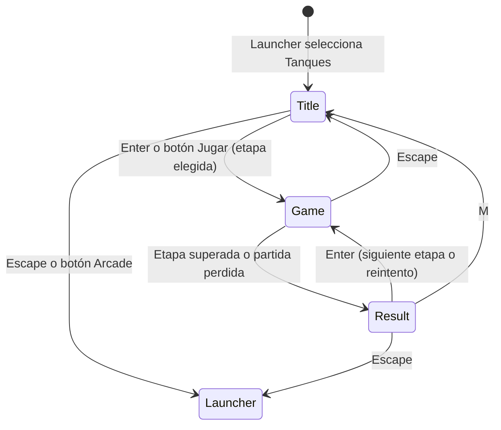

# Tanques: diseño técnico y funcionalidades

Tanques es una versión propia de Battle City (Namco, 1985): un tanque amarillo
defiende un águila al pie del mapa contra veinte tanques enemigos por etapa.
Los mapas, los gráficos y los números son originales del arcade; de Battle
City se toman las reglas y el ritmo.

Este documento debe actualizarse cuando cambien controles, reglas, balance,
escenas o funcionalidades.

## Flujo de escenas



| Escena | Clave | Responsabilidad |
| --- | --- | --- |
| `TanksTitleScene` | `tanks:title` | Controles, bonus, elección de etapa o mapa aleatorio con vista previa |
| `TanksGameScene` | `tanks:game` | Teclado → `Battle`, dibujo, sonidos, marcador y pausa |
| `TanksResultScene` | `tanks:result` | Planilla de bajas, récord y cómo seguir |

`TanksGameScene` recibe un `CampaignState` (`stage`, `score`, `lives`,
`playerLevel` y, en partidas aleatorias, `seed`) y le entrega a la planilla un `TanksResult` con el estado al
terminar. Ganar arranca la etapa siguiente con ese estado; perder reintenta la
misma etapa desde cero.

## Controles

| Entrada | Acción |
| --- | --- |
| Flechas o WASD | Mover. Si se apretan dos, manda la última |
| Espacio, Z o J | Disparar |
| P | Pausar o reanudar |
| Escape | Volver al título |
| ← → en el título | Elegir la etapa inicial o ALEATORIO |
| N en el título | Otro mapa aleatorio |
| Enter / M / Escape en la planilla | Seguir / título / launcher |

## Reglas

- Cada etapa tiene veinte enemigos. Hay como máximo cuatro en el campo y van
  saliendo por tres puntos de aparición en la fila de arriba.
- Se pierde si una bala toca el águila (también una propia) o si el jugador
  pierde su último tanque. Se arranca con dos tanques de reserva.
- Los enemigos número 4, 11 y 18 titilan en rojo: el primer tiro que reciben
  hace aparecer un bonus en un lugar al azar del mapa.
- Las balas enemigas no se dañan entre sí; una bala del jugador y una enemiga
  que chocan se anulan.
- Cada 20.000 puntos se gana un tanque extra.

### Enemigos

| Tipo | Velocidad | Bala | Blindaje | Puntos |
| --- | --- | --- | --- | --- |
| Básico | lenta | lenta | 1 | 100 |
| Rápido | rápida | lenta | 1 | 200 |
| Potente | media | rápida | 1 | 300 |
| Blindado | media | lenta | 4 | 400 |

El blindado cambia de color con cada impacto: verde, amarillo, naranja y gris.

### Bonus

| Bonus | Efecto |
| --- | --- |
| Estrella | Mejora el cañón: bala rápida → dos balas → rompe acero |
| Granada | Destruye a todos los enemigos del campo, sin dar puntos |
| Casco | Escudo durante 10 s |
| Pala | La pared de la base pasa a ser acero por 18 s; titila antes de volver |
| Reloj | Congela a los enemigos 10 s |
| Tanque | Un tanque de reserva más |

Agarrar un bonus suma 500 puntos. Perder un tanque devuelve el cañón al
nivel 0.

## Terreno y colisiones

Todo se mide en unidades del campo: el campo mide 208, un tanque 16 y el
terreno se guarda en celdas de 4 (una grilla de 52×52). La escena dibuja cada
unidad a 2,75 px.

- **Ladrillo**: frena tanques y balas. Cada impacto se lleva una hilada de 4
  unidades de profundidad y 16 de ancho, centrada en la bala. Así una pared de
  media baldosa aguanta dos tiros, y un tanque alineado la atraviesa de a poco,
  como en el original. La primera versión usaba celdas de 8 y la pared de la
  base caía con un solo tiro: con el jugador quieto el águila duraba menos de
  veinte segundos.
- **Acero**: frena todo. Sólo lo rompe una bala de cañón nivel 3.
- **Agua**: frena tanques, no balas.
- **Bosque**: no frena nada y se dibuja por encima de los tanques.

Al doblar 90° el tanque se alinea a la media baldosa (8 unidades) más cercana.
Sin ese ajuste sería casi imposible embocar un pasillo del ancho exacto del
tanque. Dos tanques sólo se frenan al acercarse; si quedaron superpuestos al
aparecer, cualquiera puede alejarse.

## Inteligencia de los enemigos

Cada enemigo avanza en línea recta y cambia de rumbo al vencer un temporizador
de 1 a 4 s o al quedar trabado. Al elegir rumbo:

- con una probabilidad que empieza en 5 % y crece hasta 45 % a lo largo de la
  etapa, va hacia el águila;
- con 20 %, hacia el jugador;
- si no, elige al azar con preferencia por bajar.

Contra una pared dispara el doble, así que termina abriendo camino. La
frecuencia de disparo y el intervalo entre apariciones se endurecen con cada
etapa. Todos estos números viven en `constants/tuning.ts`.

## Mapas

Seis etapas definidas en `constants/levels.ts` como grillas de 13×13 bloques
(`#` ladrillo, `@` acero, `~` agua, `%` bosque y `[ ] ^ _` para medios
ladrillos). El cargador siempre deja libres los puntos de aparición y arma la
fortaleza del águila, así que ningún mapa puede trabar la partida. Un mapa con
otro tamaño o una formación que no sume veinte enemigos falla al cargar.

Después de la sexta etapa la campaña sigue con mapas generados y una formación
veterana: pocos básicos y muchos rápidos, potentes y blindados. La semilla se
sortea al llegar a la etapa 7 y viaja con la partida, así que reintentar una
etapa perdida repite su mapa.

### Mapas aleatorios

En el título, después de la etapa 6 aparece **ALEATORIO** con una semilla de
cinco cifras; N o un click sobre el mapa piden otra. Cada etapa de esa partida
genera su mapa a partir de la semilla y del número de etapa, así que la misma
semilla repite exactamente la misma serie de mapas. La semilla queda a la
vista en el marcador y en la planilla para poder anotarla. Las formaciones de
enemigos son las mismas que en la campaña.

`state/mapGenerator.ts` produce el mismo formato de 13×13 caracteres que los
mapas escritos a mano:

1. Arma la mitad izquierda (con la columna central) colocando piezas al azar:
   columnas, paredes, bloques de 2×2, manchas de bosque y paredes finas de
   medio ladrillo. Ocupa entre un 34 % y un 44 % de los bloques.
2. La refleja hacia la derecha. La simetría es lo que hace que un mapa al azar
   parezca diseñado.
3. Lo acepta sólo si las tres apariciones enemigas, la del jugador y el frente
   de la base quedan conectadas. Ladrillo y bosque cuentan como paso porque el
   ladrillo se rompe a tiros; acero y agua no. Si no, prueba otro candidato.

El acero gana peso con cada etapa: los primeros mapas se abren a tiros y los
últimos obligan a rodear. En 8000 generaciones de prueba ninguna necesitó el
mapa de respaldo previsto para el caso de que fallen 60 intentos seguidos.

## Estado y representación

`state/Battle.ts` contiene la simulación completa y no importa Phaser. Recibe
la entrada con `setInput`, avanza con `step(dt)` y deja en `events` lo que pasó
(disparos, impactos, explosiones, bonus) para que la escena lo convierta en
sonido, explosiones y puntajes flotantes. La escena avanza la simulación a
pasos fijos de 1/60 s, así que se juega igual en cualquier monitor.

`objects/battleRenderer.ts` dibuja todo con `Graphics` vectoriales en vez de
texturas: se rasterizan a la resolución real del canvas y se ven nítidos con
el zoom de `core/renderScale.ts`. La vista previa del título también construye
una `Battle` real, para que nunca se desfase del juego.

El récord se guarda en `localStorage` con la clave `tanks.highScore`.

## Verificación

`npm run shots -- tanks` recorre el título, la elección de etapa, la cortina,
un disparo, la pausa, la planilla de una etapa superada, la etapa 2, la caída
del águila, una partida con mapa aleatorio y el paso de la etapa 6 a la 7, la
primera generada. Para no depender de la puntería, el recorrido fuerza el final de
la etapa a través de `window.arcade` (sólo existe en desarrollo).

## Estructura

```text
tanks/
├── index.ts               manifiesto
├── sceneKeys.ts
├── audio.ts               música y efectos en R2
├── tanks.md
├── constants/
│   ├── levels.ts          mapas, formaciones, base y puntos de aparición
│   └── tuning.ts          tamaños, velocidades, tiempos e IA
├── state/
│   ├── Battle.ts          simulación de una etapa
│   ├── mapGenerator.ts    mapas aleatorios simétricos y jugables
│   ├── rng.ts             números al azar con semilla
│   └── highScore.ts       récord en localStorage
├── objects/
│   ├── battleRenderer.ts  terreno, tanques, balas, bonus y explosiones
│   └── labels.ts          claves de texto de bonus y enemigos
└── scenes/
    ├── TanksTitleScene.ts
    ├── TanksGameScene.ts
    └── TanksResultScene.ts
```

## Próximos pasos

- Segundo jugador en el mismo teclado.
- Hielo, que en el original hace patinar al tanque.
- Editor de mapas, como el "Construction" del original.
