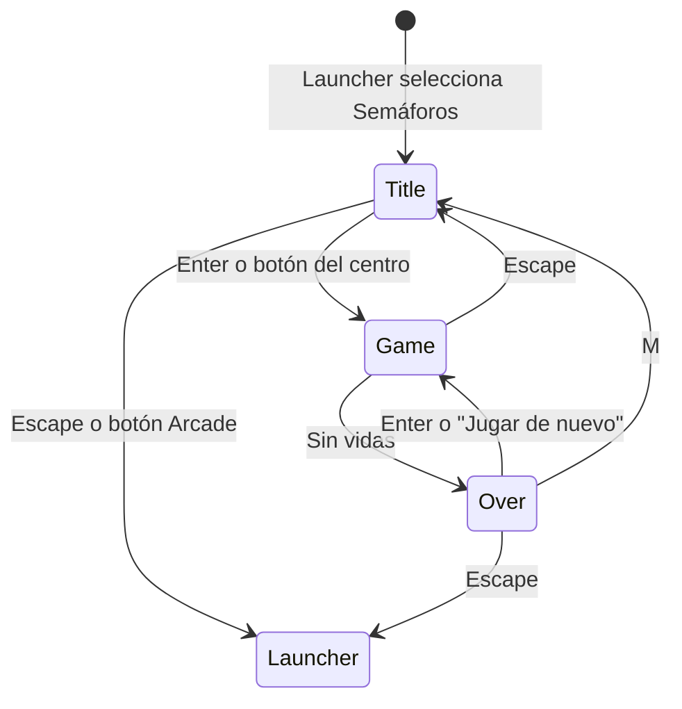

# Semáforos: diseño técnico y funcionalidades

Semáforos del Centro es un juego de gestión de tráfico en tiempo real. El
jugador maneja a mano los cuatro semáforos de un cruce céntrico: nada cambia
solo. Cada coche que sale suma puntos; un choque o un coche que se cansa de
esperar cuestan una vida. Se empieza con tres y no se gana: se juega por
puntaje.

Las reglas salen del GDD "Semáforos del Centro" 1.0. Las decisiones que el GDD
dejaba abiertas y las que agregó el diseño están marcadas abajo.

Este documento debe actualizarse cuando cambien controles, reglas, balance,
escenas o funcionalidades.

## Flujo de escenas



| Escena | Clave | Responsabilidad |
| --- | --- | --- |
| `TrafficTitleScene` | `traffic:title` | El cruce con todo en rojo y coches esperando, reglas, destinos y récord |
| `TrafficGameScene` | `traffic:game` | Clicks y teclas → `Traffic`, dibujo, marcador, efectos y sonidos |
| `TrafficGameOverScene` | `traffic:over` | Puntaje, tiempo, coches, choques, impaciencias, récord y reinicio |

`TrafficGameScene` le entrega a la pantalla final un `TrafficResult`
(`score`, `time` y las estadísticas de la partida).

## Controles

| Entrada | Acción |
| --- | --- |
| Click sobre un semáforo | Pasarlo de rojo a verde o al revés |
| Flechas o WASD | Lo mismo con el semáforo de ese lado de la pantalla (↑ norte, → este, ↓ sur, ← oeste) |
| Escape | Volver al título |
| Enter / M / Escape al final | Jugar de nuevo / título / launcher |

El GDD pide sólo click. Las flechas se sumaron porque el resto del arcade se
juega entero con teclado y porque permiten al recorrido de capturas manejar el
juego sin coordenadas. No hay pausa, como pide el GDD.

## Reglas

- Cuatro semáforos, uno por acceso. Todos arrancan en rojo. Cambiar uno no
  cuesta nada.
- Cada coche obedece sólo al semáforo de su acceso.
- Se circula por la derecha. Cada calle tiene un carril por sentido y los tres
  movimientos (derecho, izquierda, derecha) salen del mismo carril. El giro a la
  izquierda cruza el carril contrario: norte y sur en verde a la vez es seguro
  sólo si nadie dobla a la izquierda.
- **Destino visible** (agregado al GDD). Cada salida tiene un color y una letra:
  A azul al norte, B amarilla al este, C magenta al sur y D blanca al oeste. Un
  cartel con la letra y unos chevrones del mismo color marcan cada salida. El
  coche se pinta con el color de su destino y lleva la letra en el techo. Los
  colores evitan el rojo y el verde de los semáforos. Además, el coche guiña del
  lado hacia el que va a doblar y frena con luces rojas.
- **Línea de no retorno**. Un coche que ya pasó la línea de parada ignora el
  semáforo. Si el semáforo se pone en rojo cuando ya no le alcanza el frenado
  para detenerse antes de la línea, sigue de largo. Cortar el verde nunca deja
  un coche a mitad del cruce.
- Un coche frena detrás de otro de su mismo carril y deja un hueco mínimo.
  Dentro del cruce también frena por uno que tiene adelante con un rumbo
  parecido, lo que evita los choques al desembocar en la misma salida. Los que
  se cruzan perpendiculares o de frente no se ven: chocan.
- **Choque**: se superponen las carrocerías (achicadas un 15 % para que un roce
  no cuente). Los dos coches se retiran y se pierde una vida. El GDD habla de
  distancia entre centros; con eso, dos coches que se cruzan en ángulo recto se
  atravesaban a la vista sin chocar.
- **Paciencia**: baja sólo con el coche detenido y se recupera de a poco cuando
  avanza. La barra aparece en cuanto el coche empieza a esperar y pasa de verde
  a amarillo y a rojo, donde titila. Si llega a cero, el coche se va enojado y se
  pierde una vida.
- **Puntaje según la paciencia** (agregado al GDD). Un coche paga
  `ceil(10 × paciencia restante)`: 10 si nunca esperó, 1 como mínimo. Se mide al
  cruzar la línea de parada, porque ahí termina su espera. El "+N" sale del
  cartel de la salida, del color que tenía su barra en ese momento.
- La partida termina con cero vidas. La simulación se congela 1,6 s mostrando el
  último golpe y pasa a la pantalla final.
- Una entrada con la cola hasta el borde de la pantalla no recibe coches: se
  sortea otra. Si están todas tapadas, se espera.

## Balance

Todos los números viven en `constants/tuning.ts`.

| Valor | Inicial |
| --- | --- |
| Vidas | 3 |
| Puntos por coche | 10 con la paciencia llena, baja en proporción, mínimo 1 |
| Intervalo de aparición | 1,4 s → 0,7 s en 150 s, ±15 % al azar |
| Paciencia | 9–14 s; baja 1 s por segundo detenido, se recupera 0,35 s por segundo en marcha |
| Barra | verde > 60 %, amarillo > 30 %, rojo |
| Velocidad | 115–150 px/s; acelera a 220 px/s² y frena a 300 px/s² |
| Destinos | 50 % derecho, 25 % a cada lado |

### Simulador

`npm run sim:traffic` juega cientos de partidas sin navegador (por defecto 200
por jugador) y mide lo que pide la sección 11 del GDD. Juegan cuatro
jugadores automáticos:

- **Todo verde**: nunca toca nada después de abrir todo.
- **Todo rojo**: no toca nada.
- **Ciclo fijo**: 4 s norte-sur, 4 s este-oeste, con 1,2 s de todo rojo entre
  fases.
- **De a un brazo**: verde para la cola más impaciente, de a una por vez, y
  espera que el cruce se vacíe antes de cambiar. Es la estrategia segura.

Resultados con los valores iniciales (60 partidas por jugador):

| Jugador | Duración media | Puntos | Cómo pierde |
| --- | --- | --- | --- |
| Todo rojo | 18 s | 0 | Impaciencia |
| Todo verde | 59 s | 382 | Choques |
| Ciclo fijo | 58 s | 311 | Choques: giros a la izquierda contra el que viene de frente |
| De a un brazo | 141 s | 830 | Impaciencia: no despacha suficientes coches cuando sube el ritmo |

Que la estrategia segura pierda alrededor de los dos minutos y medio es lo que
le da techo a la dificultad. Para durar más hay que combinar accesos
compatibles, por ejemplo norte y sur en verde cuando nadie dobla a la
izquierda.

Que "todo verde" dure casi un minuto quiere decir que los choques al azar son
poco frecuentes al principio. Si al jugar se siente muy permisivo, se puede
acortar el intervalo inicial o reducir `CRASH_SHRINK`.

## Estado y representación

`state/Traffic.ts` contiene la simulación completa y no importa Phaser. Recibe
los clicks con `toggle`, avanza con `step(dt)` y deja en `events` lo que pasó
(aparición, cambio de semáforo, coche que sale, choque, impaciencia, fin) para
que la escena lo convierta en dibujo, efectos y sonido. La escena avanza la
simulación a pasos fijos de 1/60 s, así que se juega igual en cualquier monitor.
`stats` guarda las métricas del GDD: coches que salieron, choques,
impaciencias, máximo de coches detenidos a la vez y segundos en rojo de cada
semáforo.

`state/routes.ts` genera las trayectorias desde el mapa. Cada ruta es recta de
entrada → tramo dentro del cruce → recta de salida. Dentro del cruce, seguir
derecho es una recta y doblar es un cuarto de circunferencia, cerrado a la
derecha y abierto a la izquierda. El coche sólo guarda cuánto avanzó; posición
y rumbo salen de `poseAt`.

Todo se dibuja con `Graphics` vectoriales, que se rasterizan a la resolución
real del canvas y se ven nítidos con el zoom de `core/renderScale.ts`:

- `objects/cityRenderer.ts`: manzanas, edificios vistos desde arriba, árboles,
  calzada, divisoria, sendas peatonales, líneas de parada y salidas. Usa un azar
  con semilla para que la ciudad salga igual en las tres pantallas.
- `objects/lightRenderer.ts`: los semáforos, su zona clicable, la línea de
  parada pintada del color de la luz y el resaltado del carril bajo el puntero.
- `objects/carRenderer.ts`: carrocería, vidrios, faros, luces de freno, guiños
  y barra de paciencia. Cada coche es un `Container` que la escena ubica y rota;
  la letra va en un `Text` aparte para leerse siempre derecha.
- `objects/effects.ts`: estallido del choque, marca de enojo y corazones.

El récord se guarda en `localStorage` con la clave `traffic.highScore`.

## Preparado para lo que viene

Ideas para versiones futuras: varios cruces como niveles, calles con más
carriles y que el jugador pueda prohibir giros en un cruce para ordenar el
tráfico. Ninguna está en la v1, pero tres decisiones ya las contemplan porque
serían caras de cambiar después:

1. **El mapa es un dato.** `constants/layouts.ts` describe cruces, brazos,
   carriles y salidas; v1 trae uno solo, `CENTRO`. Rutas, semáforos, carteles y
   dibujo se derivan de ese valor.
2. **El coche guarda su salida, no su giro.** El giro de cada cruce se deduce
   de la ruta. Con varios cruces, el destino define el recorrido completo.
3. **Identificadores para varios cruces.** Un semáforo es `cruce:acceso` (por
   ejemplo `centro:N`) y cada acceso tiene una lista de carriles con los
   movimientos que permite, como las flechas pintadas en el asfalto. Las reglas
   de seguimiento y de choque ya funcionan con carriles paralelos.

Queda pendiente, hasta que haya un caso real: calcular recorridos entre varios
cruces, dibujar calles de más de un carril por sentido, la interfaz para
prohibir giros (hoy cada carril permite los tres) y una cámara para mapas que
no entren en 800×600.

## Verificación

`npm run shots -- traffic` recorre el título, las colas en rojo, norte y sur en
verde con el puntero sobre el semáforo del este, un choque, una impaciencia, el
último golpe, la pantalla final, el reinicio y el título y el final en inglés.
Para no esperar el final entero, el recorrido baja las vidas a través de
`window.arcade` (sólo existe en desarrollo).

## Estructura

```text
traffic/
├── index.ts                 manifiesto
├── sceneKeys.ts
├── audio.ts                 música y efectos en R2
├── traffic.md
├── constants/
│   ├── layouts.ts           mapas: cruces, carriles y salidas con color y letra
│   └── tuning.ts            medidas, velocidades, paciencia, dificultad y puntos
├── state/
│   ├── routes.ts            trayectorias generadas desde el mapa
│   ├── Traffic.ts           simulación de una partida
│   └── highScore.ts         récord en localStorage
├── objects/
│   ├── cityRenderer.ts      ciudad, calles y salidas
│   ├── lightRenderer.ts     semáforos y líneas de parada
│   ├── carRenderer.ts       coches y barra de paciencia
│   ├── effects.ts           choque, enojo y corazones
│   └── labels.ts            letras de semáforos y salidas, formato del tiempo
└── scenes/
    ├── TrafficTitleScene.ts
    ├── TrafficGameScene.ts
    └── TrafficGameOverScene.ts
```

## Próximos pasos

- Varios cruces como niveles.
- Calles con más carriles por sentido.
- Prohibir giros en un acceso para ordenar el tráfico.
